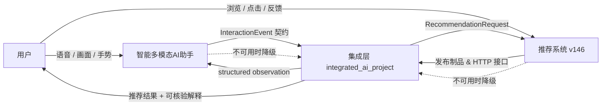
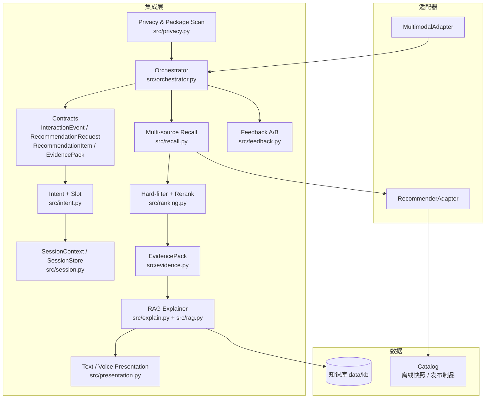
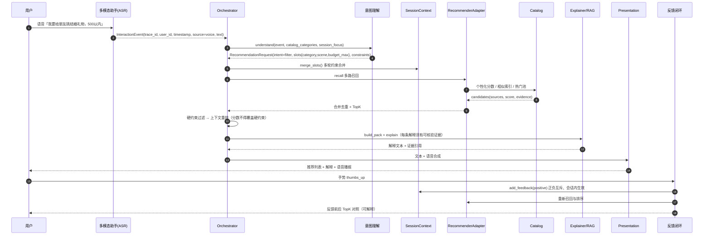
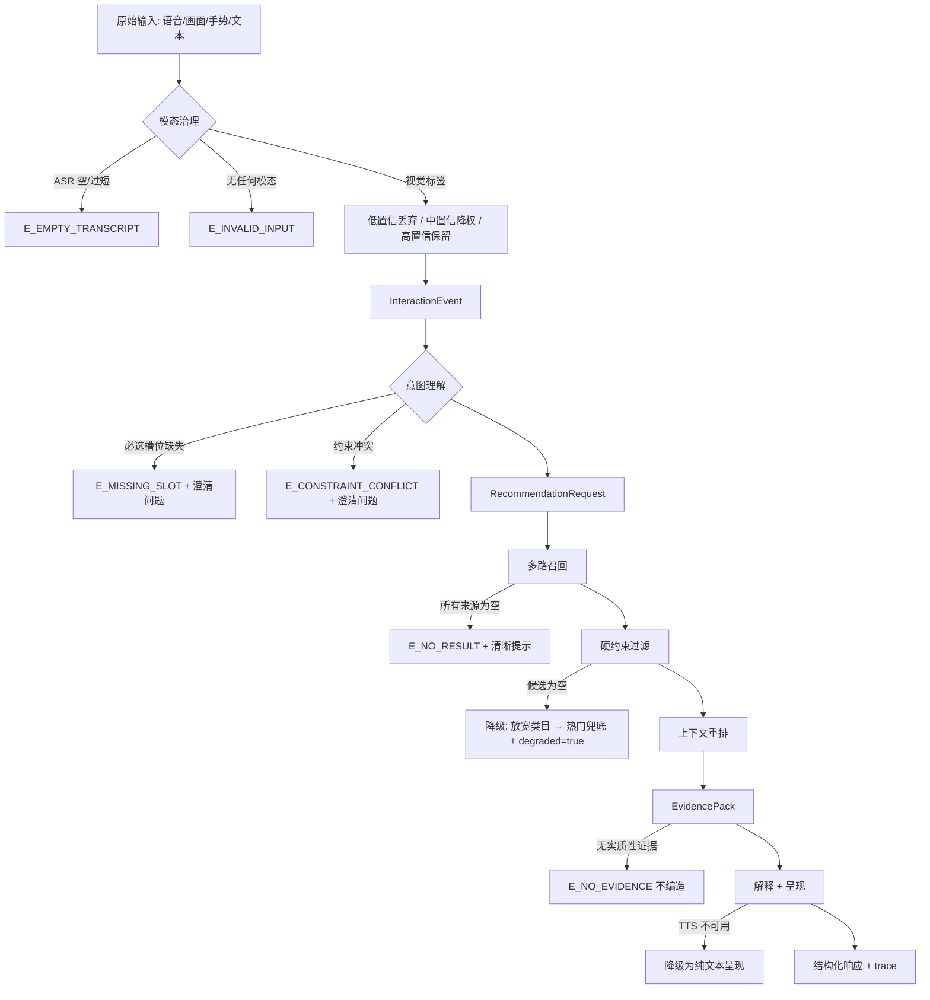

# 多模态个性化推荐助手 · 系统架构与接口契约

> 阶段1 交付物 · 系统上下文图 / 容器图 / 主链路时序图 / 数据流 / 失败出口

## 1. 系统上下文

把原本相互独立的两套系统整合为「通过稳定接口协作」的一个工程系统：

- **智能多模态AI助手**（外部系统 A）：语音识别 ASR、视觉语言理解 VL、姿态与手势识别、知识库 RAG、TTS
- **推荐系统 v146**（外部系统 B）：XGBoost pairwise 精排 + 相似索引 + 商品目录 + 价格映射
- **集成层**（本项目 `integrated_ai_project`）：事件协议、意图理解、会话状态、多路召回、可控精排、证据解释、反馈闭环、验收与证据



**边界原则（阶段1 验收项）**：集成层只通过适配器访问两个外部系统，
不 import 对方的内部模块、不读取对方的内部变量/GUI 对象。

## 2. 容器图



## 3. 主链路时序图（语音要礼物 → 推荐 → 点赞反馈）



## 4. 数据流与 trace 字段

每一次请求都携带统一信封字段：

| 字段 | 含义 | 取值示例 |
|---|---|---|
| `trace_id` | 全链路追踪 ID | `tr-1ce83e38da02433a` |
| `user_id` | 用户标识 | `15547` |
| `timestamp` | UTC ISO8601 | `2026-10-13T09:08:25+00:00` |
| `source` | 事件来源 | `voice` / `vision` / `gesture` / `text` / `feedback` / `system` |
| `session_id` | 会话标识（用于约束合并与偏好隔离） | `sess-15547\|2026-10-13` |
| `schema_version` | 契约版本 | `1.0.0` |



## 5. 失败出口与降级矩阵

| 场景 | 触发条件 | 降级路径 | 级别 |
|---|---|---|---|
| 推荐系统 HTTP 不可用 | 连接失败/超时/未登录 | local_artifacts（发布制品） → offline_snapshot（内置快照） | L1 |
| 推荐系统制品缺失 | 文件不存在 | offline_snapshot 内置快照 | L2 |
| 真实多模态模型不可用 | torch/mediapipe 缺失或未授权 | 离线场景桩（data/cases 模态输入） | L1 |
| ASR 文本为空/过短 | 有效时长 < 400ms 或文本长度 < 2 | 返回 `E_EMPTY_TRANSCRIPT`，不臆测意图 | L2 |
| RAG 无命中 | 最高相似度 < min_score | 仅用结构化字段解释，不编造 | L2 |
| 硬约束过滤后无结果 | candidates = 0 | 放宽软约束 + 热门兜底，`degraded=true` | L1 |
| 语音呈现不可用 | TTS 合成失败/超时 | 仅文本呈现，`voice_available=false` | L2 |
| 单路召回超时 | 适配器超时 | 该路失败，其余来源继续，trace 留痕 | L1 |

> 降级矩阵以 `config/settings.py:DEGRADATION_MATRIX` 为唯一来源，
> 契约测试（01）会自检每一行是否含 `scenario/fallback/level`。

## 6. 分层与模块职责

| 层 | 模块 | 职责 | 不允许做的事 |
|---|---|---|---|
| 契约层 | `src/contracts.py` `src/errors.py` | 数据结构、JSON 校验、错误码 | 不写业务逻辑 |
| 适配层 | `src/adapters/*` | 与外部两系统交互、降级、调用日志 | 不 import 对方内部模块 |
| 领域层 | `src/intent.py` `src/session.py` `src/recall.py` `src/ranking.py` | 意图、会话、召回、排序 | 不直接读写外部系统 |
| 证据层 | `src/evidence.py` `src/explain.py` `src/rag.py` | 证据包、RAG、解释 | 不编造事实 |
| 呈现层 | `src/presentation.py` | 文本/语音呈现 | 不修改事实 |
| 编排层 | `src/orchestrator.py` | 串联主链路、trace、降级 | 不堆放具体算法 |
| 入口层 | `main.py` `scripts/*` | 演示与证据生产 | 不硬编码商品 ID/路径/密钥 |

## 7. 正常样例与边界样例

> 本节由 `scripts/08_gen_docs.py` 从真实运行结果生成，随证据文件一同更新。

<!-- SAMPLES:START -->
### 样例 A · 正常链路（语音要礼物 → 推荐 → 解释）

```json
{
  "input": {
    "source": "voice",
    "text": "我要给朋友挑一个结婚礼物，500以内"
  },
  "trace_id": "tr-5b344ea75663b581",
  "status": "ok",
  "intent": "filter",
  "hard_constraints": [
    {
      "field": "price",
      "op": "lte",
      "value": 500.0,
      "kind": "hard",
      "source": "slot:budget_max"
    },
    {
      "field": "category",
      "op": "eq",
      "value": "装饰品",
      "kind": "hard",
      "source": "slot:category"
    }
  ],
  "top5": [
    {
      "rank": 1,
      "item_id": "20829",
      "title": "闪粉悬挂蝴蝶串",
      "price": 2.1,
      "score": 0.7228,
      "sources": [
        "推荐系统 v146 个性化精排"
      ]
    },
    {
      "rank": 2,
      "item_id": "21175",
      "title": "金汤力饮食金属标牌",
      "price": 2.55,
      "score": 0.69915,
      "sources": [
        "推荐系统 v146 个性化精排"
      ]
    },
    {
      "rank": 3,
      "item_id": "20828",
      "title": "闪粉蝴蝶发夹",
      "price": 2.55,
      "score": 0.6887,
      "sources": [
        "推荐系统 v146 个性化精排",
        "相似商品召回"
      ]
    },
    {
      "rank": 4,
      "item_id": "21166",
      "title": "用酒烹饪金属标志",
      "price": 2.08,
      "score": 0.67275,
      "sources": [
        "推荐系统 v146 个性化精排",
        "品类热门召回"
      ]
    },
    {
      "rank": 5,
      "item_id": "21169",
      "title": "你把我搞糊涂了金属标志",
      "price": 1.69,
      "score": 0.6227,
      "sources": [
        "推荐系统 v146 个性化精排"
      ]
    }
  ],
  "latency_ms": {
    "event_ms": 0.074,
    "intent_ms": 0.704,
    "recall_ms": 2.17,
    "rank_ms": 0.509,
    "present_ms": 0.025,
    "dispatch_ms": 3.278,
    "total_ms": 4.301
  }
}
```

- 召回来源（source / status / count）：[('personalized', 'ok', 80), ('similar', 'ok', 36), ('category_hot', 'ok', 61), ('history', 'ok', 80), ('popular', 'ok', 80)]
- 硬约束核验：输入候选 120 条 → 淘汰 91 条 → 降级 False
- Top1 解释（只取证据包中的事实）：

> 推荐理由：它属于「装饰品」品类。参考价 £2.1（来源：historical_mode）。符合你的预算要求：价格 2.1 不超过 500.0。符合你的品类要求：装饰品（要求 装饰品）。它来自「推荐系统 v146 个性化精排」这一路的候选。知识库依据（01_品类选品指南#3）：选购建议： - 明确类目后，再叠加颜色与预算约束，命中率显著高于只给类目。 - 茶烛台、相框这类小件家居装饰价格多在 1-6 英镑区间，适…

### 样例 B · 边界：约束冲突（预算下限高于上限）

```json
{
  "input": {
    "source": "text",
    "text": "1000以上500以内的东西"
  },
  "trace_id": "tr-c62524c21facf2ca",
  "status": "conflict",
  "error": {
    "code": "E_CONSTRAINT_CONFLICT",
    "message": "你给的预算下限 1000.0 高于上限 500.0，请确认。",
    "field": "budget_range",
    "context": {
      "conflicts": [
        {
          "id": "budget_range",
          "desc": "预算下限高于上限",
          "detail": {
            "min": 1000.0,
            "max": 500.0
          },
          "hint": "你给的预算下限 1000.0 高于上限 500.0，请确认。"
        }
      ],
      "intent_result": {
        "intent": "filter",
        "intent_confidence": 1.0,
        "intent_scores": {
          "discover": 0.0,
          "similar": 0.0,
          "filter": 1.3,
          "compare": 0.0,
          "feedback": 0.0,
          "explain": 0.0
        },
        "slots": {
          "budget_max": {
            "name": "budget_max",
            "value": 500.0,
            "confidence": 0.85,
            "evidence": [
              "文本预算表达 「以上1000.0」，「以内500.0」 → 上限 500.0"
            ]
          },
          "budget_min": {
            "name": "budget_min",
            "value": 1000.0,
            "confidence": 0.85,
            "evidence": [
              "文本预算表达 「以上1000.0」，「以内500.0」 → 下限 1000.0"
            ]
          },
          "budget_raw": {
            "name": "budget_raw",
            "value": {
              "min": 1000.0,
              "max": 500.0,
              "target": 500.0,
              "direction": "range",
              "raw": "「以上1000.0」，「以内500.0」",
              "evidence": "文本预算表达 「以上1000.0」，「以内500.0」"
            },
            "confidence": 0.7,
            "evidence": [
              "文本预算表达 「以上1000.0」，「以内500.0」"
            ]
          }
        },
        "constraints": [
          {
            "field": "price",
            "op": "lte",
            "value": 500.0,
            "kind": "hard",
            "source": "slot:budget_max"
          },
          {
            "field": "price",
            "op": "gte",
            "value": 1000.0,
            "kind": "hard",
            "source": "slot:budget_min"
          }
        ],
        "missing_slots": [],
        "conflicts": [
          {
            "id": "budget_range",
            "desc": "预算下限高于上限",
            "detail": {
              "min": 1000.0,
              "max": 500.0
            },
            "hint": "你给的预算下限 1000.0 高于上限 500.0，请确认。"
          }
        ],
        "evidence": {
          "modality": "asr",
          "text": "1000以上500以内的东西",
          "visual_tag_count": 0,
          "gesture": null
        }
      },
      "clarification": "你给的预算下限 1000.0 高于上限 500.0，请确认。"
    }
  },
  "clarification": "你给的预算下限 1000.0 高于上限 500.0，请确认。",
  "recommendations": []
}
```

### 样例 C · 边界：输入不含任何可用模态（视觉标签置信度不足被丢弃）

```json
{
  "input": {
    "source": "vision",
    "visual_tags": [
      {
        "tag": "模糊物体",
        "confidence": 0.2
      }
    ]
  },
  "trace_id": "tr-error-758299321885",
  "status": "error",
  "error": {
    "code": "E_INVALID_INPUT",
    "message": "事件不包含任何可用模态输入（text/visual_tags/gesture 至少一项）",
    "field": "spec",
    "context": {}
  }
}
```

> 样例 B/C 的共同点：信息不足时返回**结构化错误 + 澄清问题**，既不臆测意图，也不给出推荐结果。

> 复现性说明：样例中的 trace_id、商品、分数与顺序为**确定性结果**（固定 seed、固定排序键、固定 trace_hint）；latency_ms 为本次实测值，随机器与负载变化，不属于可复现承诺范围。
<!-- SAMPLES:END -->

## 8. 可复现性

- `config/settings.py:SEED = 42` 固定 Python/NumPy 随机种子
- 排序键固定：`final_score desc → base_score desc → item_id asc`
- 所有证据文件由脚本生成，脚本可反复运行得到相同结论
- 离线快照由 `scripts/build_offline_snapshot.py` 从推荐系统发布制品确定性导出
